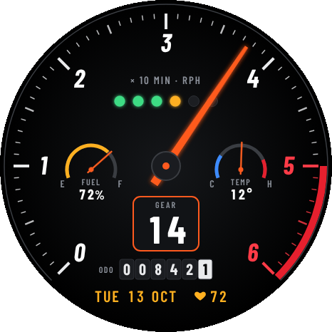

# REDLINE: tachometer watch face for Zepp OS

This is a custom watch face for the **Amazfit Active 3 Premium** (466×466 round screen, Zepp OS 5+). It also works on other round Zepp OS watches with API level 3.0 or higher.



| Element | Shows |
|---|---|
| Big needle | Minutes. One sweep per hour over a 270° scale, so the unit is **RPH**. It enters the redline at :50. |
| GEAR box | Hour (24h) |
| Shift lights | One light per 10 s of the current minute. All six flash in the last 3 s. |
| FUEL gauge | Battery %. The gauge turns red below 20 %. |
| TEMP gauge | Current weather temperature. The blue end is cold, the red end is hot. |
| ODO | Steps today |
| Bottom line | Day, date, month and heart rate |

The always-on screen keeps only the dial, an outlined needle, the gear and the date.

## 1. Enter the temporary environment (Nix flake)

You need Nix with flakes enabled; nothing gets installed system-wide.
```bash
cd redline-watchface
nix develop          # Node.js + zeus CLI (installed into ./.nix-npm on first run)
```
**With direnv:** the repo has an `.envrc` (`use flake`). Run `direnv allow` once, and the environment loads automatically whenever you `cd` into the folder (and unloads when you leave). [nix-direnv](https://github.com/nix-community/nix-direnv) makes this fast and cached. With direnv, you can skip the `nix develop` lines below.

Exit with `exit` or Ctrl-D, and everything is gone from your PATH again. To remove it completely, delete `.nix-npm/` (and `~/.zepp/`, where zeus stores your login).

> If you `git init` this folder, run `git add flake.nix` first. Flakes only see tracked files.

No Nix? Install Node.js LTS and run `npm i -g @zeppos/zeus-cli` instead.

## 2. Try it in the simulator (optional)

The Zepp OS Simulator isn't in nixpkgs, so download it separately:
https://docs.zepp.com/docs/guides/tools/simulator/download/ (on Arch, use the Linux `.deb` through `debtap` or the AUR).
```bash
nix develop
zeus dev
```
Start the simulator, switch on **Device Simulator**, and pick a 466×466 round device. The simulator's controls let you change the battery, steps, heart rate and weather values.

## 3. Install it on the watch

### Option A: Zepp app QR code (works on iPhone and Android)
1. In the Zepp app, open **Profile → Settings → About** and tap the Zepp logo **7 times**. This turns on Developer Mode.
2. On the PC:
   ```bash
   nix develop
   zeus login      # free Zepp developer account (opens a browser)
   zeus preview    # builds it and prints a QR code
   ```
   When it asks for a target, pick the one for your watch.
3. In the Zepp app, go to **Profile → your watch → scroll to the bottom → Developer Mode → Scan**, then scan the QR code. The face installs, and you can select it from the watch-face list.

### Option B: Gadgetbridge (Android only)
1. `nix develop`, then `zeus build`, creates a `.zab` file in `dist/`.
2. Copy it to the phone and open it with Gadgetbridge, which installs it as a watch face.

## Tweaking the look
All images are generated from `tools/studio.html`, which holds the colours, sizes and labels. After editing it:
```bash
nix develop .#assets                            # Python + Playwright + Chromium, temporary
python tools/gen.py assets/default.r/images     # re-render all PNGs
python tools/preview.py docs/preview.png        # composite preview
python tools/preview.py docs/preview_aod.png aod
```
Positions are in `watchface/index.js`. If you move something there, update `tools/preview.py` to match.

## Known unknowns (check on first install)
- **TEMP needle**: it uses the system weather data binding (`IMG_POINTER` + `WEATHER_CURRENT`). The number is always correct, but Zepp doesn't document how the needle maps temperature to its range. If the needle position looks off, tell Claude and it can switch to a different approach.
- **Always-on**: the needle and gear update once a minute through `Time.onPerMinute`. If they freeze in always-on mode on your firmware, that's the thing to report.
- **appId**: if `zeus preview` complains about the app ID, create a watch face in the Zepp developer console (https://console.zepp.com) and paste its ID into `app.json → app.appId`.
